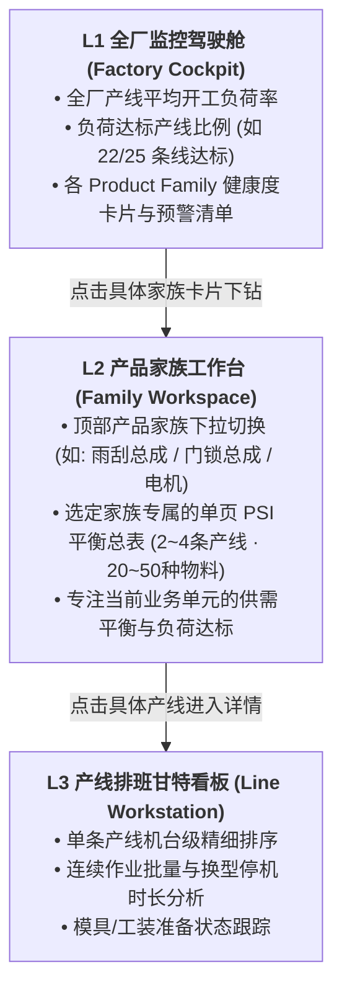
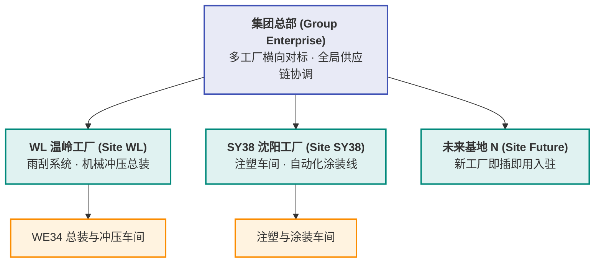

# 自研智能排产系统 Functional Specification

**版本**：0.7 工业级数据闭环与全要素穿透审计演进版  
**日期**：2026-10-23  
**状态**：落地甘特图料号独立时间轨防重叠、主数据源标准整合至 dataSource.xlsx、规则合规审计算式与逐班验算底表穿透、手工调整 Excel 上传二次合规审计与空班放空智能归因诊断  
**文档目的**：作为自研 APS 从单车间验证走向全厂及多工厂部署的企业级系统功能规格书，用于与物流专家、各基地车间计划员、IT/算法研发团队对齐业务规则、计算边界、租户隔离与技术验收标准。

**0.7 变更摘要**：
1. **甘特图料号独立时间轨重构 (Sub-lanes De-overlap)**：
   - 产线泳道（PGLINKAGE 与 轴套6）支持展开为分料号专属时间轨（Sub-lanes），各料号排产工单在线性时序上**绝对零重叠**；
   - 支持在工具栏一键切换“分料号独立时间轨 (防重叠)”与“产线聚合单轨”双重视图。
2. **生产主数据源彻底规范化与整合 (`dataSource.xlsx`)**：
   - 清理所有冗余废弃表单与乱码，构建标准纯净的 `dataSource.xlsx`（包含 12 张标准制造业务表单与 UTF-8 规则源）；
   - 全系统（CLI、RESTful 服务及规则加载器）默认数据源统一切换为 `dataSource.xlsx`。
3. **独立二次校验与规则合规审计数据穿透 (Data Drill-downs)**：
   - 无论 PASS 还是 FAIL，17 项独立硬指标验证器与规则矩阵均支持穿透查看判定公式、量化指标徽章及逐班验算底表；
   - 典型如 **R-WL-11（跨班次连续生产与换模计算）**，清晰量化呈现：全期换型次数、跨班切换次数、**跨班沿用上一班模具/夹具继承次数（继承率）** 与 **免停机换模节约工时（`saved_setup_hours`）**。
4. **手工调整排产 Excel 上传独立合规审计闭环**：
   - 计划员在本地对导出的排产 Excel 进行手工调优后，可在 Tab 5 重新上传；
   - 后台自适应兼容单一平衡表与 `Production plan-Done` 格式，运行全套规则校验并实时标红违规，支持与算法原方案一键恢复比对。
5. **空班放空理由智能诊断引擎 (Shift Idle Diagnostics)**：
   - 构建 `diagnose_empty_shifts` 智能诊断引擎，对所有利用率为 0 的班次输出 5 大归因标签（订单完工封盘、不足95%精益合批、工序搭接缓冲、日历休工、PM设备维保）；
   - 负荷概览表单元格集成 `ℹ️` 悬停气泡提示。
6. **物料平衡表产品排产状态过滤切换器**：
   - 标题栏右侧增加“只看排产计划的产品 (YY)”与“看所有产品 (XX)”过滤切换器，纯前端 Filter 聚焦当前在排系列。

**0.6 变更摘要**：
1. **30 天需求前瞻平准合批引擎落地**：针对订单覆盖全月、月初空闲而月末集中爆单的问题，构建前瞻拉单机制；在满足即期交期前提下，仅拉动在产料号远期订单提前生产备库，消除为凑负荷而引入的碎片小单，实现换型趋零与跨期平准。
2. **统一多工厂站点架构全量运行**：
   - **WL 工厂**：8h × 3 班制，雨刮总装（PGLINKAGE）+ 轴套冲压（轴套6），27 条全要素排产规则；
   - **SY38 工厂**：12h × 2 班制，自动化涂装线（PU07/PU22）+ 大型注塑机（1400T-6），9 条专属注塑涂装工艺规则（共模1:1、换模频次≤2、涂装12h静置缓冲等）。
3. **新增【⑥ ⚙️ 生产策略与系统设置】专属工作台**：收拢原顶部导航栏臃肿控件，支持计划期、工作制模式、前瞻开关与拉单上限依托工厂站点独立持久化存储。
4. **Excel 规则最新演进同步**：更新 `R-WL-03`（削峰填谷跨期预排）与 `R-WL-26`（95%~105% 班次双边利用率硬约束）。

**0.5 变更摘要**：
1. **39 项全要素排产原则与约束体系升级（重构第 5.2 节）**：
   - 规则库从原 30 项全面扩充至 **39 项全要素约束体系**，新纳入口模具物理互斥（`R-TL-01`）、关键物料预计入库（`R-MT-01`）、设备 PM 维保停机挂起（`R-PM-01`）、客户战略评级加权保障（`R-CR-01`）及前后道时间围栏冻结（`R-SF-04`, `R-FG-04`）等关键工业约束；
   - 建立 **9 大业务类型**（核心排班、物料与库存、设备与产能、异常应对、测试场景、工装与人员、订单与交期、需求倒排、系统架构）与 **5 类约束性质**（物理可行性硬约束、强工艺/业务硬约束、准硬约束、可松弛软约束、全局优化目标）双维治理矩阵。
2. **规则业务化简炼命名与 AI 规范化解析（Excel Col D & Col G 落地）**：
   - 前端采用一句话简明业务名称（Col D）清晰呈现规则含义；
   - 算法内核与前端展开手风琴全面绑定 Excel Col G 规范化解析（数学逻辑公式、业务边界、场景示例），实现业务与数学模型无缝对齐。
3. **独立合规验证器扩容至 17 项独立硬指标**：
   - 验算引擎从 9 项扩展为 17 项独立验证器，排产后对 39 项规则进行物理级复核，全量输出 39 项合规审计矩阵。
4. **架构评审（/grill-me）五大关键技术决议落地**：
   - **主数据拓扑表扩展**：规范《模具工装绑定表》、《物料到货计划(PO/ETA)》、《设备PM维保日历》三种专用数据格式，消除硬编码；
   - **冻结期与顺位前拉严格解耦**：冻结窗格（$T \le T_{\text{Freeze}}$）内工单为 P0 级不可变硬约束，顺位前拉仅允许从 $T > T_{\text{Freeze}}$ 的未来池按时间正序抽取；
   - **极端超载三级客户分流策略**：战略客户（10x权重）保供 100%，A 级客户（3x权重）平移次选窗口，B 级客户（1x权重）顺延或输出外协建议；
   - **PM 跨班维保挂起与免重算恢复**：PM 班次工时硬归零，跨 PM 工单自动切片挂起并在复工后无缝恢复，免除二次换模惩罚；
   - **三阶日历自适应推荐与一键采纳**：引擎根据周负荷智能推荐做四休三/做五休二/连续生产，计划员确认后一键采纳并驱动求解。

---

## 1. 背景与目标

### 1.1 背景

公司为离散/流程复合型汽车零部件制造企业，在全国拥有多个生产基地（如浙江温岭工厂 WL、辽宁沈阳工厂 SY38 等）。各工厂生产模式具有鲜明的行业工艺特征：
- **温岭工厂（WL）**：以 WE34 车间为代表，典型工艺为“前道多工位高速冲压 $\to$ 后道雨刮传动杆/连杆流水总装”；
- **沈阳工厂（SY38）**：以汽车外饰件与功能件车间为代表，典型工艺为“大型注塑机（如 1400T-6） $\to$ 自动化涂装线（PU07/PU22） $\to$ 烘烤固化总成”。

当前各工厂日常排产高度依赖本地物流计划员的 Excel 手工经验，面临跨工序动态平衡难、订单频繁变动重排慢、各工厂数据与规则割裂、缺乏统一数字化作业平台的深层痛点。

### 1.2 项目发展阶段与目标

#### 阶段一：车间级 MVP 原型（已完成并验证）
- 聚焦 WL 工厂 WE34 车间：一条雨刮总装线（`PGLINKAGE`）与一条前道轴套冲压线（`轴套6`），覆盖 17 种产成品与 20 种半成品。
- 建立两阶段物料动态联动排程引擎，生成班次级高精度生产计划。
- 验证指标：准时交付率（100%）、开工负荷率（$\ge 95\%$ 达标）、最小批量（MPQ 整倍化）、物料流水零断线，计算耗时秒级。

#### 阶段二：全厂级多产线/多产品家族扩展（当前推进）
- 在单工厂内推广至全厂数十条总装线与数十条半成品线；
- 确立以 **Product Family（产品家族）** 为核心的解耦计算与管理边界，确保算力消耗线性可控、结果稳定无交叉污染；
- 建立三级下钻交互体系，兼顾厂级宏观统筹与产线精细调优。

#### 阶段三：集团级多工厂多租户协同（本次架构升级确立）
- 统一 UI 框架、统一算法引擎底座，支持各工厂独立运行；
- 实现**“权限隔离、数据自治、规则定制、算力独立”**；
- 集团总部拥有宏观驾驶舱，支持跨工厂横向对标与协同调度。

---

## 2. 系统定位与核心设计原则

1. **业务语言导向，严禁技术黑话**：
   系统直接面向车间调度员与物流计划员，全界面及报表严禁出现算法内部词汇（如 OR-Tools、CP-SAT、求解器、数学规划等），统一采用“智能排产引擎”、“生产计划编制”、“产线开工负荷”、“工序流水动态平衡”等标准制造业物流术语。
2. **多工厂界面统一，数据与规则自治**：
   温岭工厂与沈阳工厂使用同一套视觉组件与交互框架，降低集团数字化培训成本；但各工厂拥有专属的数据空间、上传接口与本地规则开关。
3. **实用主义，100% 接受次优可行解**：
   离散制造车间现场受模具、物料、工装等物理条件约束，追求全局绝对最优解不仅耗时过长，且现场鲁棒性差。系统在受控时间（30 秒~1 分钟）内给出**满足所有硬约束、业务满意、优于人工的次优可行解**。
4. **参数配置与运算触发严格解耦**：
   调整工厂日历、勾选/取消规则、修改需求或库存时，系统仅在前端静默更新配置，**绝不自动隐式触发重排**；必须由计划员主动点击“🚀 执行智能排产”后，引擎才进行批量计算，给予用户充足的确认与掌控感。
5. **向导式诊断替代机械报错**：
   当遭遇产能严重超载或订单不可行时，系统禁止抛出无意义的代码错误，必须提供结构化的瓶颈工时缺口数据，并给出“切换 7×3 连续生产”、“延长计划期至 15 天”、“周末定向加点补班”等业务一键修复建议。

---

## 3. 核心业务概念与术语定义

| 业务术语 | 英文标识 | 业务定义与系统落点 |
| :--- | :--- | :--- |
| **工厂站点** | Plant / Site | 具备独立法人或物理地理位置的制造单元（如 WL 温岭工厂、SY38 沈阳工厂）。权限隔离与数据自治的顶级实体。 |
| **产品家族** | Product Family (PF) | 工艺相似、通常绑定固定总装线及专有前道机台的一组产品集合。**APS 独立计算的最大隔离边界**。 |
| **产线负荷率** | Loading Rate | 某班次产线有效生产工时占单班额定工时的比例。公式为 $\frac{\sum (\text{产量} \times \text{CT})}{3600 \times 8 \times \text{TRP}}$。门槛为 $\ge 95\%$。 |
| **工时有效率** | TRP | 设备综合效率与产线利用率定额基准（如装配线 0.71，冲压线 0.85）。 |
| **最小包装批量**| MPQ | 产线单批次投产或转运的最小物理包装约束，单班投产严禁低于该值。 |
| **物料平衡总表**| PSI Matrix | 包含 Customer Demand（需求）、Production Plan（排产）、Stock Balance（结存库存）、Coverage Days（周转天数）四行推移的动态平衡看板。 |
| **早班交付截单**| Morning Cut-off | 每日客户发货提货以当日早班结束（15:00）为物理基准线，前夜及当日早班产出须在 15:00 前累计覆盖交付需求。 |
| **换色过渡矩阵**| Color Changeover | 涂装与注塑车间从浅色切换至深色（白 $\to$ 银 $\to$ 灰 $\to$ 黑）的最小清洗时间与损耗序列约束。 |
| **TPM 维保窗口** | Maintenance Slot | 产线预防性维护时段（如模具每冲压 5 万次刃磨 4 小时），日历中标记后严禁排入任何生产任务。 |

---

## 4. 问题规模、计算复杂度与分治边界设计

### 4.1 全厂多产线规模下的复杂度分析（为什么不能做成一个大模型？）

当系统从单线扩展至全厂数十条线、上千种物料时，若将全厂所有产线混在一个数学模型中同时求解：
- **状态变量与约束规模**：
  $$\text{变量数} \approx (\text{订单行数}) \times (\text{工序层级}) \times (\text{排产班次数}) \times (\text{候选机台数})$$
- 混合整数规划与约束规划（MIP/CP）属于 NP-Hard 难题，全局搜索空间随变量呈组合爆炸：
  $$\text{计算时间} \sim O(2^N) \text{ 或 } O(b^D)$$
- **实测结论**：混合大模型在超过 5 条总装线后，求解耗时会从秒级陡增至半小时以上甚至内存溢出（Memory Exceeded），极度不稳定且无法应对突发重排需求。

### 4.2 以 Product Family 为边界的分治并行架构

为了让计算时间稳定可控，系统在工厂内部按“产品家族（Product Family）”实施**分治求解（Divide-and-Conquer）**：

```
                              ┌────────────────────────────────────────┐
                              │ 工厂订单池 (ERP / WMS / EDI Release)   │
                              └───────────────────┬────────────────────┘
                                                  │ 按 Product Family 物理归属分流
                   ┌──────────────────────────────┼──────────────────────────────┐
                   ▼                              ▼                              ▼
        ┌─────────────────────┐        ┌─────────────────────┐        ┌─────────────────────┐
        │ Product Family 1    │        │ Product Family 2    │        │ Product Family K    │
        │ 雨刮总成与冲压轴套  │        │ 门锁总成与冲压连杆  │        │ 电机系统与机加工壳体│
        │ 2条产线 · 37种物料  │        │ 3条产线 · 45种物料  │        │ 2条产线 · 28种物料  │
        └──────────┬──────────┘        └──────────┬──────────┘        └──────────┬──────────┘
                   │ 并行线程 1                   │ 并行线程 2                   │ 并行线程 K
                   ▼ (15s)                        ▼ (22s)                        ▼ (12s)
        ┌───────────────────────────────────────────────────────────────────────────────────┐
        │ 结果聚合总控器 (Result Aggregator): 全厂耗时 = max(T_i) ≈ 22秒 (多核并发常数级)    │
        └─────────────────────────────────────────┬─────────────────────────────────────────┘
                                                  ▼
                        全厂 L1 监控驾驶舱 + 各家族 L2 PSI 动态平衡总表
```

- **单家族规模受控**：每个产品家族内部通常包含 1~3 条总装线及关联的 1~3 条前道冲压/注塑线，物料规模在 30~60 种之间。变量规模被牢牢锁定在一个小常数范围内，单家族求解固定在 **10~30 秒**。
- **总耗时模型**：
  - **单核串行计算**：总耗时 $T_{\text{total}} = \sum_{k=1}^K T_k$ ，随家族数量 $K$ 严格呈**线性增长**；
  - **多核并发计算（推荐）**：在 8 核/16 核服务器上并发执行，$T_{\text{total}} = \max(T_k)$，全厂总耗时**始终保持在 30 秒左右**！

### 4.3 跨家族物理拓扑关系与隔离防错机制

如何保证各类成品与半成品在分治计算时**不相互影响、不导致错误**？根据工厂设备与物料共享关系分为三类拓扑进行严格隔离：

| 拓扑分类 | 典型制造场景 | 潜在冲突风险 | 架构隔离与协同机制 |
| :--- | :--- | :--- | :--- |
| **拓扑 A：完全独立专用型** | 总装专线专用，冲压专机专用，BOM 完全独立。 | **零风险**。无资源竞争。 | 各家族彻底独立分派给独立线程计算，结果直接拼装，100% 互不干扰。 |
| **拓扑 B：共享前道重型机台** | 各家族有独立总装线，但前道冲压共用一台 1400T 冲压机或一条电泳涂装线。 | 若盲目分开计算，两家族可能同时抢占周二早班冲压机，导致单班负荷超 8h，前道被打爆、总装断线。 | **两级分层协调架构（Hierarchical APS）**：<br/>1. **顶层工时切片（Capacity Slicing）**：先按各家族订单工时占比，对共享机台各班次划分配额（如 Family 1 分 5h，Family 2 分 3h）；<br/>2. **底层各家族独立求解**：各家族在前道配额边界内运行平衡算法，确保物理绝对可行。 |
| **拓扑 C：通用平台标准件** | 标准销轴、紧固件跨多个产品家族共用。 | 细微物料耦合导致全厂模型关联。 | **安全库存与 ROP 解耦**：跨家族通用件不参与总装日排程的高维动态联动，由物料仓库通过再订货点（ROP）或安全库存批量补货制独立保障。 |

---

## 5. 核心功能规格

### 5.1 三阶工厂日历与平准化调度引擎

系统提供动态工厂日历工作台，支持各工厂独立灵活定义生产基准与班次可用性：

1. **排产跨度（Horizon Options）**：
   - 支持 **5 天（短期精细排）**、**10 天（标准两周滚动，默认）**、**15 天（半月扩展平准）** 三种计划期。
   - 基准日 $D+0$ 冻结不可变，$D+1$ 早班（默认 10/12 07:00）作为排产起始点。
2. **三大标准工作模式**：
   - `SEVEN_ZERO`（连续生产）：7天×3班（21班/周），全量释放产线 240h 理论产能；
   - `FIVE_TWO`（正常均衡）：5天×3班（15班/周），周六日双休，标准平准化排程；
   - `FOUR_THREE`（极度空闲）：4天×3班（12班/周），周五至周日停工节能，周四晚预做库存覆盖周末提货。
3. **班次级颗粒度微调与 TPM 维保锁定**：
   - 用户可点选任意日期或班次单元格，独立打开/关闭特定班次。
   - 冲压模具或注塑机检修班次（TPM）锁定后，排产引擎自动将该工位标记为不可用，严禁排入工单。
4. **节假日逆向倒排备库（Rule R-BK-01）**：
   - 遇周六日或法定节假日停工时，客户在休息日及次周一早班的提货需求，系统自动逆向倒排至周五早/中/晚班提前生产入库，留足安全库存防止周一开工断供。

### 5.2 规则注册表与双维治理体系 (39 项全要素约束)

系统内置完整的 **39 项全要素排产规则体系**（来源于《APS Database- Simulation draft.xlsx》工作表《排产原则-约束条件》），彻底替代早期 30 条粗粒度规则，建立制造业物理级与管理级全面对齐的工业约束框架：

#### 5.2.1 双维分类与治理矩阵
1. **维度一：约束类型 (9 大业务范畴，Excel Col C)**：
   - **核心排班 (18 条)**：工单顺位前拉（R-SF-02, R-FG-05）、MPQ 整倍化与跨班连续合并（R-SF-09, R-FG-02, R-FG-06）、时间围栏冻结（R-SF-04, R-FG-04）、三阶日历自适应（R-CL-01..03）等；
   - **物料与库存 (6 条)**：前后工序流水齐套防断线（R-SF-03）、早班 15:00 客户提货刚性截单（R-FG-01）、月末安全库存上限（R-SF-08, R-FG-10）、日终库存覆盖次日发货（R-FG-11）、关键物料预计入库 ETA 齐套开工（R-MT-01）；
   - **设备与产能 (4 条)**：单班负荷达标率 $\ge 95\%$（R-SF-01, R-FG-03）、单班换型频次上限 $\le 3$ 次（R-FG-13）、设备预防维护（PM）停机避让与挂起（R-PM-01）；
   - **异常应对 (4 条)**：跨周期负荷峰谷弹性平抑（R-EX-01）、月度交界借调产能（R-EX-02）、分段弹性日历模板（R-EX-03）、极限超载交期延期与外协平移建议（R-EX-04）；
   - **测试场景 (4 条)**：低负荷做四休三（R-TC-01）、突发高峰升阶（R-TC-02）、前半月爆单（R-TC-03）、极限超载阻断（R-TC-04）全流程自检断言；
   - **工装与人员 (1 条)**：多设备共用同一模具/工装物理排他独占（R-TL-01）；
   - **订单与交期 (1 条)**：产能受限时战略/A/B级客户梯次加权保障（R-CR-01）；
   - **需求倒排 (1 条)**：节假日/休息日发货需求逆向倒排休前完工备库（R-BK-01）；
   - **系统架构 (1 条)**：产线与工作日历数据彻底解耦（R-AR-01）。

2. **维度二：约束条件/性质 (5 级物理与业务属性，Excel Col E)**：
   - **物理可行性硬约束**：不满足则产生物理干涉或断线（如模具物理互斥 R-TL-01、物料入库时序 R-MT-01、PM停机工时归零 R-PM-01、BOM齐套 R-SF-03）；
   - **强工艺/业务硬约束**：工艺或客户契约底线（如早班交付 R-FG-01、冻结期锁定 R-FG-04/R-SF-04、95%负荷门槛 R-SF-01/R-FG-03）；
   - **准硬约束**：允许局部可控松弛的工程准则（如顺位前拉连续性 R-SF-02/R-FG-05、单班换型 $\le 3$ 次 R-FG-13）；
   - **可松弛软约束**：多目标加权惩罚项（如工作日优先排产 R-SF-07/R-FG-09、月末安全库存 R-SF-08/R-FG-10、客户分级惩罚 R-CR-01）；
   - **全局优化目标 / 架构规范**：宏观策略与测试断言（R-AR-01, R-EX-01, R-TC-01..04）。

#### 5.2.2 业务简炼命名与 AI 规范化解析（Excel Col D & Col G）
- **前端一句话呈现**：彻底消除冗长晦涩的描述，采用 Col D 提炼的一句话业务语言展示（如“多设备共用的同一模具/工装具备物理独占性，严格禁止跨设备时段冲突”），用户一眼即明其管理含义；
- **Col G 算法模型对齐**：规则工作台展开手风琴，直接呈现 Col G 原生【逻辑公式】、【业务边界】与【场景示例】，作为算法建模与人工调优的唯一真实源（Single Source of Truth）。

#### 5.2.3 运筹优化求解映射与 17 项独立合规验证器
- **动态开关联动**：界面 39 项规则 Checkbox 与后端求解器开关矩阵联动，开启对应项时激活 CP-SAT 的数学约束或目标函数惩罚项；
- **17 项独立合规校验器（Validator Matrix）**：
  求解完成后，系统不依赖求解器自身声称，而是由独立的物理验证引擎针对排程结果进行 17 项无死角二次验算（早班交付、BOM齐套、负荷达标、工单锁量、MPQ整倍、换型频次、日历匹配、周末排休、倒排备库、冻结期围栏、模具跨线互斥、物料入库时序、PM避让、客户评级保障等），输出结构化的 39 项合规审计报告。

### 5.3 架构评审决议沉淀：冻结期、PM挂起、超载分级与自适应日历

基于系统架构研讨（`/grill-me`），系统固化以下五项企业级制造执行规范：

1. **时间围栏（冻结期）与顺位前拉严格解耦（R-SF-04, R-FG-04, R-SF-02, R-FG-05）**：
   - 设冻结跨度 $T_{\text{Freeze}}$（如前 2 个工作日共 6 班）。凡落入 $t \le T_{\text{Freeze}}$ 内的工单作为 **P0 级锁定约束**，排产引擎严禁变更机台、数量与班次；
   - 当某班次开工负荷不足 95% 触发顺位前拉时，引擎**严禁在冻结区内调整**，仅允许从 $t > T_{\text{Freeze}}$ 的待排工单池中，按需求交期正序无缝抽取紧邻工单前置填补。
2. **设备预防维护（PM）停机避让与跨班挂起机制（R-PM-01）**：
   - PM 班次物理可用工时硬性置 0，严禁排入任何生产负荷；
   - 跨 PM 窗口的长批次工单，系统将其有效生产工时自动切片，PM 前完成部分切片，PM 结束后**无缝挂起恢复**继续生产，不重复施加二次换模或清理惩罚。
3. **极端超载三级客户保供梯次分流（R-CR-01, R-EX-04）**：
   - 当需求超出全月理论总产能时，系统拒绝盲目无解，根据客户等级分配加权惩罚：
     - **战略客户（Strategic Tier，10x 惩罚）**：100% 优先锁定核心班次与优势产线，交付达成率必须 100%；
     - **A 级客户（Standard Tier A，3x 惩罚）**：允许在交期附近 $\pm 1$ 天窗口内微调平移；
     - **B 级客户（Flexible Tier B，1x 惩罚）**：自动延期或生成结构化外协平移建议清单（Subcontract Advice）。
4. **三阶日历自适应推荐与一键采纳（R-CL-01..03, R-EX-03）**：
   - 引擎预检时根据周总工时需求动态推算最佳匹配制式（$W \le 4/7$ 推荐做四休三，$4/7 < W \le 5/7$ 推荐做五休二，$W > 5/7$ 推荐升阶连续生产）；
   - 前端弹出自适应推荐建议卡片，由计划员一键确认采纳并生效，兼顾算法智能化与人类计划员的掌控权。
5. **专用拓扑数据接口规范化**：
   - 在数据底座中扩展独立的《模具工装与机台绑定表》、《关键物料到货计划(PO/ETA)》与《设备PM维保日历》，与标准订单和日历彻底解耦解耦维护。

### 5.4 生产排程与物料平衡总表（PSI Matrix）

排产主界面 Tab 1 严格对齐车间经典 PSI 报表结构：
1. **严格列垂直对齐**：
   - 前 4 列固定显示：`Site/料号`、`产线/品名描述`、`监控指标/业务项`、`定额/基准参数`；
   - 班次列双层表头：首行按自然日合并单元格，次行展开班次（早班、中班、晚班）；
2. **【上表】产线负荷概览（Line Loads Overview）**：
   - 每条产线呈现 3 行：生产工时（Loading Hours）、TRP 定额、开工负荷率（Loading Rate）；
   - 负荷率 $\ge 95\%$ 达标自动填充柔和浅绿，尾班豁免浅黄，未达标突出浅红。
3. **【下表】物料动态平衡表（Material Balance Matrix）**：
   - 支持产成品（FG）、半成品（SFIN）及“合并同屏展示（ALL 37）”视图；
   - 每种物料严格按 4 行纵向推移：
     - **Customer Demand**：提货需求数值，有需求班次黄色高亮；
     - **Production Plan**：排产计划数量，生产班次蓝色高亮；
     - **Stock Balance**：结存库存滚动推移，负库存红色预警；
     - **Coverage Days**：库存可用天数，$\le 2$ 天提示备料告警。

### 5.5 单页式 Excel 导出规格

点击“导出结果 Excel”时，系统基于已排产的 `ValidationMatrix` 动态生成**仅包含单个工作表**的标准化 Excel 文件：
- **工作表名称**：`生产排程与物料平衡总表 (PSI)`；
- **排版对齐**：100% 还原网页端“合并同屏展示”样式；
- **冻结窗格**：在 `E3` 单元格锁定冻结，前 4 列及双层日期班次表头在水平/垂直滚动时全程浮动常驻；
- **视觉样式**：细灰边框、色块高亮（排产淡蓝、达标淡绿、需求淡黄、异常淡红）及加粗分隔线均与系统屏幕展示保持一致。

### 5.6 交互式甘特图与工位工作台

Tab 2 提供直观的横道图排班工作台：
- 严格按日期与班次切分时间刻度，任务块颜色区分产成品（蓝色）与半成品（黄色）；
- **BOM 穿透交互**：点击总装工单卡片，甘特图自动高亮闪烁其所消耗的前道冲压零件任务块及其齐套提前量；点击半成品卡片，自动高亮其供应的成品总装工单；
- **安全缓冲看板**：直观展示任务完工时间与客户交期之间的安全裕量（Slack Hours），超期风险一目了然。

---

## 6. 全厂多产线扩展与展示架构

为了解决产线数量激增时的“硬编码”与“界面信息过载”问题，建立三级下钻模型与元数据驱动体系：

### 6.1 三级下钻导航模型（Three-Tier Navigation）



### 6.2 元数据驱动消除硬编码（Data-Driven Metadata）

- **数据契约解耦**：前端页面（HTML/Vue）严禁在代码中写死任何具体产线名称（如 `PGLINKAGE`、`轴套6`）或特定指标名；
- **动态循环渲染**：后台统一通过 `/api/family/{family_id}/matrix` 接口返回动态结构：
  ```json
  {
    "family_id": "PF_WIPER",
    "family_name": "雨刮系统总成家族",
    "lines": [
      { "line_id": "PGLINKAGE", "line_name": "雨刮总成装配线", "type": "FG", "utilization": 97.1 },
      { "line_id": "STAMP_06", "line_name": "轴套冲压6号线", "type": "SF", "utilization": 96.9 }
    ],
    "shift_columns": [ ... ],
    "line_loads": [ ... ],
    "materials": [ ... ]
  }
  ```
  前端通过 `v-for="line in family.lines"` 动态生成顶部监控卡片和负荷表格，工厂新增、修改任何产线均无需前端二次开发。

---

## 7. 多工厂多租户架构与数据/规则隔离规范 (Multi-Plant Multi-Tenancy)

为了支撑温岭工厂（WL）、沈阳工厂（SY38）以及未来其他基地的独立运行与集团统筹，系统建立多工厂多租户隔离架构：

### 7.1 五级组织与权限层级模型



- **权限角色隔离矩阵**：
  - **工厂调度员（Plant Scheduler）**：账号硬绑定所属工厂代码（如 `WL` 或 `SY38`），登录后直接锁定在本厂工作台，**严格物理阻断对其他工厂数据的读写权限**；
  - **工厂厂长 / 物流部长（Plant Director）**：查看所属工厂全部车间、产品家族与产线的全局报表与排产合规审计；
  - **集团供应链总监 / 专家（Group SC Officer）**：具备“全局漫游权限”，可通过顶部快捷下拉框在各工厂间切换，并在集团驾驶舱横向对比各工厂的准时交付率（OTD）、产能利用率和库存资金占用。

### 7.2 工艺差异与插件化规则库架构（Core Rules + Plant Plugins）

不同工厂具备完全不同的制造物理特征。系统采用**“通用排产内核 + 工厂专属工艺插件”**的设计范式：

| 工厂站点 | 核心制造场景 | 专属工艺规则插件 (Plant Plugins) |
| :--- | :--- | :--- |
| **WL 温岭工厂**<br/>(机械制造) | 冲压 $\to$ 雨刮流水总装 | 1. **单班开工负荷达标率 $\ge 95\%$**（避免大装配线频繁开关机）；<br/>2. **冲压模具 5 万次冲压定期刃磨 TPM 锁定**；<br/>3. **早班 15:00 客户提货刚性截单**；<br/>4. **前后工序整批 MPQ 转运防断线**。 |
| **SY38 沈阳工厂**<br/>(注塑与涂装) | 1400T 注塑 $\to$ 自动化喷涂 $\to$ 烘烤固化 | 1. **涂装由浅入深换色矩阵（Color Sequencing）**：白 $\to$ 银 $\to$ 灰 $\to$ 黑顺排，反向切换触发 2 小时洗枪停机惩罚；<br/>2. **重型模具行车吊装互斥（Crane Lock）**：1400T 模具更换需共用车间行车，单班换模上限 $\le 2$ 次，且禁止相邻机台同时换模；<br/>3. **烘烤固化时效时间窗（Curing Window）**：喷漆完成后 45 分钟内必须入炉固化，防止漆面氧化。 |
| **通用排产内核**<br/>(所有工厂共享) | 基础计划编排逻辑 | 1. 客户订单交期硬约束；<br/>2. 工单锁量防超产闭环；<br/>3. 三阶工厂日历（7x3/5x3/4x3）与周末逆向倒排；<br/>4. 粗能力瓶颈预检与产能超载异常拦截。 |

### 7.3 数据自治与自服务导入协议（Data Onboarding Gateway）

为支持各工厂自主导入数据，系统建立标准化的自服务数据协议，通过前置网关实施严密防呆：

```
各工厂计划员上传 ───> [数据校验网关 Data Gateway] ───通过───> 生成租户隔离快照 Snapshot
                           │
                           ├── 校验 1: BOM 孤儿料号断链 ───> 标红拦截
                           ├── 校验 2: 物料缺少 CT/TRP 定额 ───> 阻断并提示补充
                           └── 校验 3: 负库存 / 倒挂交期 ───> 给出具体 Excel 行号警示
```

1. **数据导入协议规范（“3+3+4”标准化表结构）**：
   - **基础主数据组**：
     - `工厂主数据表.xlsx`：产线、CT节拍、TRP、MPQ、BOM比例（低频维护）；
     - `动态需求与库存表.xlsx`：订单号、料号、交期、数量、当前物理在库（每日排产上传）；
     - `工厂日历维护表.xlsx`：月度工作制、特定班次开关（按周/月维护）。
   - **高阶拓扑与约束主数据组（已于仿真数据库及前端 Tab 4 工作台全量落地）**：
     - `Tooling-Mold`（工装模具约束，支撑 `R-TL-01`）：模具编号、适用产线、零件号、可用套数、换模耗时、冲次寿命与保养周期；
     - `Preventive-Maintenance`（设备预防维护，支撑 `R-PM-01`）：设备编号、TPM类型、停机起止班次、停机工时、0%有效产能与处置策略；
     - `Material-Arrival-ETA`（关键物料到货，支撑 `R-MT-01`）：PO采购单号、零件号、预计到货班次(ETA)、数量、质检耗时及状态；
     - `Customer-Priority`（客户战略评级，支撑 `R-CR-01`）：客户代码、战略等级、惩罚倍率(10x/3x/1x)、OTD目标与委外策略。
2. **校验防呆网关（Validation Gateway）**：
   - 彻底拦截脏数据，杜绝由于主数据缺失引发的排产引擎崩溃。

### 7.4 算力与服务隔离（Compute Isolation & Job Workers）

- **无状态计算 Worker 池**：排产计算请求封装为无状态的 Job；
- **资源互不争抢**：若温岭工厂与沈阳工厂在同一时间点点击“执行智能排产”，任务将被分发至不同的 Worker 进程独立运算；
- **单点故障隔离**：某工厂的数据异常或超时报错，被限定在本地上下文沙箱内，绝对不会影响其他工厂的正常排产与界面浏览。

---

## 8. 质量与验收标准

| 验收维度 | 指标项 | 验收达标线 | 验证方式 |
| :--- | :--- | :--- | :--- |
| **业务交付** | 客户订单准时交付率 (OTD) | **100%**（在产能可行区间内） | 校验各工单完工时间 $\le$ 需求日 15:00 截单点 |
| **产线开工** | 开工班次综合负荷率 | **$\ge 95\%$**（允许收线尾班豁免） | 校验 PSI 表中 Loading Rate 行指标 |
| **工艺齐套** | 前后道工序流水防断线 | **100% 齐套**（零断线） | 校验半成品累计产出时间点 $\le$ 成品领用时间点 |
| **规则合规** | 39项全要素规则合规矩阵 | **100% 合规通过 (39/39)** | 17 项独立硬指标验证器自动跑测并出具审计报告 |
| **计算效率** | 单产品家族排产耗时 | **$\le 30$ 秒** | 浏览器端计时器与后台日志统计（实测 2~5 秒） |
| **并发扩展** | 全厂及跨厂并发排产耗时 | **$\le 60$ 秒** | 模拟 10 个产品家族在 8 核服务器并发求解 |
| **权限隔离** | 工厂数据越权阻断率 | **100% 隔离** | 验证普通调度员无法跨厂获取或修改数据 |
| **结果交付** | 单页 Excel 导出 | **严格 1 个 Sheet** | 验证导出的 `.xlsx` 格式、冻结窗格及数据一致性 |
| **语言规范** | 用户界面与文档术语 | **零算法内部黑话** | 业务部门人员评审全界面文本与规则释义 |

---

## 9. 演进路线图

1. **第一里程碑（已完成）**：WL 车间雨刮/轴套 37 个物料端到端闭环验证；单页 PSI 表、交互甘特图、三阶工厂日历、产能超载诊断、全界面业务化语言重构。
2. **第二里程碑（已完成 M8/M9）**：
   - 落地 **39 项全要素排产原则与约束体系**，实现 9 业务类别与 5 级可行性双维矩阵治理；
   - 算法模型打通模具互斥、物料ETA时序、PM停机挂起、客户战略分级、冻结期围栏保护；
   - 建立 17 项独立合规校验器，前端全景呈现 39/39 合规审计矩阵与 Col G 算法逻辑代码手风琴；
   - 固化架构评审（/grill-me）五大关键技术决议（冻结期与前拉解耦、客户梯次分流、PM挂起恢复等）；
   - **M9 晚间收官**：在仿真库（14 表）与前端【Tab 4 输入与排产主数据】全量落地模具、PM、PO/ETA及客户评级 4 大专属数据看板，支持 KPI 统计、检索与热更新重算。
3. **第三里程碑（全厂与跨基地集成）**：
   - 部署自服务数据上传与前置校验网关（支撑标准化表结构）；
   - 激活 SY38 沈阳工厂注塑涂装工艺插件（颜色换型矩阵、行车吊装）；
   - 部署多进程并行计算集群，支持多工厂秒级并发排程。