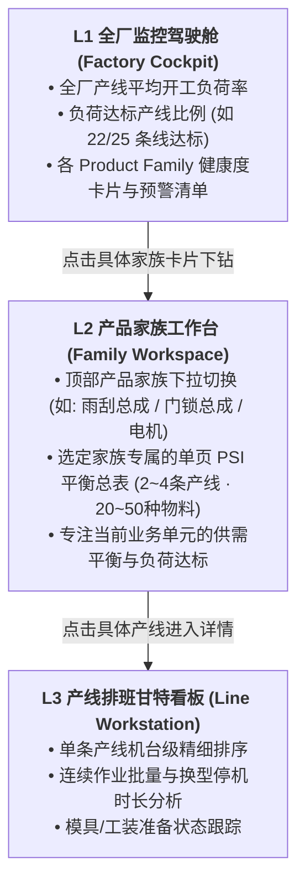
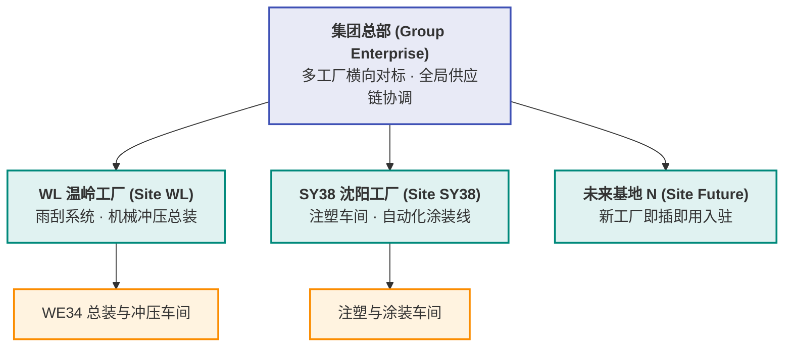

# 自研智能排产系统 Functional Specification

**版本**：0.4 演进版  
**日期**：2026-10-18  
**状态**：基于 WE34 (WL) 车间原型验证沉淀，结合全厂多产线扩展与多工厂（WL 温岭 / SY38 沈阳 / 未来基地）权限与数据自治架构规划更新  
**文档目的**：作为自研 APS 从单车间验证走向全厂及多工厂部署的企业级系统功能规格书，用于与物流专家、各基地车间计划员、IT/算法研发团队对齐业务规则、计算边界、租户隔离与技术验收标准。

**0.4 变更摘要**：
1. **多工厂多租户架构与权限隔离（新增第 7 章）**：确立五级组织层级模型（集团 $\to$ 工厂 $\to$ 车间 $\to$ 产品家族 $\to$ 产线），规范温岭工厂（WL）与沈阳工厂（SY38）及后续基地的界面隔离、数据隔离与算力隔离机制。
2. **工厂工艺特性与插件化规则库（Plant Plugins）**：提炼“通用排产内核 + 工厂工艺插件”架构，针对 WL 工厂（冲压+总装流水）与 SY38 工厂（1400T 注塑+涂装由浅至深换色矩阵、模具吊装冲突、烘烤固化时效）提供针对性规则支撑。
3. **数据自治与自服务导入协议**：规范各工厂自主上传数据时的“三表标准化协议”（主数据、动态订单库存、工厂日历）及前置数据校验防呆网关。
4. **计算时间增长模型与边界隔离**：重申以 Product Family 为最大解耦边界的分治架构，规避全厂混合大模型的超指数级组合爆炸，保证多核并发常数级响应（20~30秒）。
5. **单页 PSI 总表与无技术黑话标准**：固化已验证的单页“生产排程与物料平衡总表（PSI）”、双层垂直班次精准对齐、单页 Excel 导出及 100% 物流业务化语言规范。

---

## 1. 背景与目标

### 1.1 背景

公司为离散/流程复合型汽车零部件制造企业，在全国拥有多个生产基地（如浙江温岭工厂 WL、辽宁沈阳工厂 SY38 等）。各工厂生产模式具有鲜明的行业工艺特征：
- **温岭工厂（WL）**：以 WE34 车间为代表，典型工艺为“前道多工位高速冲压 $\to$ 后道雨刮传动杆/连杆流水总装”；
- **沈阳工厂（SY38）**：以汽车外饰件与功能件车间为代表，典型工艺为“大型注塑机（如 1400T-6） $\to$ 自动化涂装线（PU07/PU22） $\to$ 烘烤固化总成”。

当前各工厂日常排产高度依赖本地物流计划员的 Excel 手工经验，面临跨工序动态平衡难、订单频繁变动重排慢、各工厂数据与规则割裂、缺乏统一数字化作业平台的深层痛点。

### 1.2 项目发展阶段与目标

#### 阶段一：车间级 MVP 原型（已完成并验证）
- 聚焦 WL 工厂 WE34 车间：一条雨刮总装线（`PGLINKAGE`）与一条前道轴套冲压线（`轴套6`），覆盖 17 种产成品与 20 种半成品。
- 建立两阶段物料动态联动排程引擎，生成班次级高精度生产计划。
- 验证指标：准时交付率（100%）、开工负荷率（$\ge 95\%$ 达标）、最小批量（MPQ 整倍化）、物料流水零断线，计算耗时秒级。

#### 阶段二：全厂级多产线/多产品家族扩展（当前推进）
- 在单工厂内推广至全厂数十条总装线与数十条半成品线；
- 确立以 **Product Family（产品家族）** 为核心的解耦计算与管理边界，确保算力消耗线性可控、结果稳定无交叉污染；
- 建立三级下钻交互体系，兼顾厂级宏观统筹与产线精细调优。

#### 阶段三：集团级多工厂多租户协同（本次架构升级确立）
- 统一 UI 框架、统一算法引擎底座，支持各工厂独立运行；
- 实现**“权限隔离、数据自治、规则定制、算力独立”**；
- 集团总部拥有宏观驾驶舱，支持跨工厂横向对标与协同调度。

---

## 2. 系统定位与核心设计原则

1. **业务语言导向，严禁技术黑话**：
   系统直接面向车间调度员与物流计划员，全界面及报表严禁出现算法内部词汇（如 OR-Tools、CP-SAT、求解器、数学规划等），统一采用“智能排产引擎”、“生产计划编制”、“产线开工负荷”、“工序流水动态平衡”等标准制造业物流术语。
2. **多工厂界面统一，数据与规则自治**：
   温岭工厂与沈阳工厂使用同一套视觉组件与交互框架，降低集团数字化培训成本；但各工厂拥有专属的数据空间、上传接口与本地规则开关。
3. **实用主义，100% 接受次优可行解**：
   离散制造车间现场受模具、物料、工装等物理条件约束，追求全局绝对最优解不仅耗时过长，且现场鲁棒性差。系统在受控时间（30 秒~1 分钟）内给出**满足所有硬约束、业务满意、优于人工的次优可行解**。
4. **参数配置与运算触发严格解耦**：
   调整工厂日历、勾选/取消规则、修改需求或库存时，系统仅在前端静默更新配置，**绝不自动隐式触发重排**；必须由计划员主动点击“🚀 执行智能排产”后，引擎才进行批量计算，给予用户充足的确认与掌控感。
5. **向导式诊断替代机械报错**：
   当遭遇产能严重超载或订单不可行时，系统禁止抛出无意义的代码错误，必须提供结构化的瓶颈工时缺口数据，并给出“切换 7×3 连续生产”、“延长计划期至 15 天”、“周末定向加点补班”等业务一键修复建议。

---

## 3. 核心业务概念与术语定义

| 业务术语 | 英文标识 | 业务定义与系统落点 |
| :--- | :--- | :--- |
| **工厂站点** | Plant / Site | 具备独立法人或物理地理位置的制造单元（如 WL 温岭工厂、SY38 沈阳工厂）。权限隔离与数据自治的顶级实体。 |
| **产品家族** | Product Family (PF) | 工艺相似、通常绑定固定总装线及专有前道机台的一组产品集合。**APS 独立计算的最大隔离边界**。 |
| **产线负荷率** | Loading Rate | 某班次产线有效生产工时占单班额定工时的比例。公式为 $\frac{\sum (\text{产量} \times \text{CT})}{3600 \times 8 \times \text{TRP}}$。门槛为 $\ge 95\%$。 |
| **工时有效率** | TRP | 设备综合效率与产线利用率定额基准（如装配线 0.71，冲压线 0.85）。 |
| **最小包装批量**| MPQ | 产线单批次投产或转运的最小物理包装约束，单班投产严禁低于该值。 |
| **物料平衡总表**| PSI Matrix | 包含 Customer Demand（需求）、Production Plan（排产）、Stock Balance（结存库存）、Coverage Days（周转天数）四行推移的动态平衡看板。 |
| **早班交付截单**| Morning Cut-off | 每日客户发货提货以当日早班结束（15:00）为物理基准线，前夜及当日早班产出须在 15:00 前累计覆盖交付需求。 |
| **换色过渡矩阵**| Color Changeover | 涂装与注塑车间从浅色切换至深色（白 $\to$ 银 $\to$ 灰 $\to$ 黑）的最小清洗时间与损耗序列约束。 |
| **TPM 维保窗口** | Maintenance Slot | 产线预防性维护时段（如模具每冲压 5 万次刃磨 4 小时），日历中标记后严禁排入任何生产任务。 |

---

## 4. 问题规模、计算复杂度与分治边界设计

### 4.1 全厂多产线规模下的复杂度分析（为什么不能做成一个大模型？）

当系统从单线扩展至全厂数十条线、上千种物料时，若将全厂所有产线混在一个数学模型中同时求解：
- **状态变量与约束规模**：
  $$\text{变量数} \approx (\text{订单行数}) \times (\text{工序层级}) \times (\text{排产班次数}) \times (\text{候选机台数})$$
- 混合整数规划与约束规划（MIP/CP）属于 NP-Hard 难题，全局搜索空间随变量呈组合爆炸：
  $$\text{计算时间} \sim O(2^N) \text{ 或 } O(b^D)$$
- **实测结论**：混合大模型在超过 5 条总装线后，求解耗时会从秒级陡增至半小时以上甚至内存溢出（Memory Exceeded），极度不稳定且无法应对突发重排需求。

### 4.2 以 Product Family 为边界的分治并行架构

为了让计算时间稳定可控，系统在工厂内部按“产品家族（Product Family）”实施**分治求解（Divide-and-Conquer）**：

```
                              ┌────────────────────────────────────────┐
                              │ 工厂订单池 (ERP / WMS / EDI Release)   │
                              └───────────────────┬────────────────────┘
                                                  │ 按 Product Family 物理归属分流
                   ┌──────────────────────────────┼──────────────────────────────┐
                   ▼                              ▼                              ▼
        ┌─────────────────────┐        ┌─────────────────────┐        ┌─────────────────────┐
        │ Product Family 1    │        │ Product Family 2    │        │ Product Family K    │
        │ 雨刮总成与冲压轴套  │        │ 门锁总成与冲压连杆  │        │ 电机系统与机加工壳体│
        │ 2条产线 · 37种物料  │        │ 3条产线 · 45种物料  │        │ 2条产线 · 28种物料  │
        └──────────┬──────────┘        └──────────┬──────────┘        └──────────┬──────────┘
                   │ 并行线程 1                   │ 并行线程 2                   │ 并行线程 K
                   ▼ (15s)                        ▼ (22s)                        ▼ (12s)
        ┌───────────────────────────────────────────────────────────────────────────────────┐
        │ 结果聚合总控器 (Result Aggregator): 全厂耗时 = max(T_i) ≈ 22秒 (多核并发常数级)    │
        └─────────────────────────────────────────┬─────────────────────────────────────────┘
                                                  ▼
                        全厂 L1 监控驾驶舱 + 各家族 L2 PSI 动态平衡总表
```

- **单家族规模受控**：每个产品家族内部通常包含 1~3 条总装线及关联的 1~3 条前道冲压/注塑线，物料规模在 30~60 种之间。变量规模被牢牢锁定在一个小常数范围内，单家族求解固定在 **10~30 秒**。
- **总耗时模型**：
  - **单核串行计算**：总耗时 $T_{\text{total}} = \sum_{k=1}^K T_k$ ，随家族数量 $K$ 严格呈**线性增长**；
  - **多核并发计算（推荐）**：在 8 核/16 核服务器上并发执行，$T_{\text{total}} = \max(T_k)$，全厂总耗时**始终保持在 30 秒左右**！

### 4.3 跨家族物理拓扑关系与隔离防错机制

如何保证各类成品与半成品在分治计算时**不相互影响、不导致错误**？根据工厂设备与物料共享关系分为三类拓扑进行严格隔离：

| 拓扑分类 | 典型制造场景 | 潜在冲突风险 | 架构隔离与协同机制 |
| :--- | :--- | :--- | :--- |
| **拓扑 A：完全独立专用型** | 总装专线专用，冲压专机专用，BOM 完全独立。 | **零风险**。无资源竞争。 | 各家族彻底独立分派给独立线程计算，结果直接拼装，100% 互不干扰。 |
| **拓扑 B：共享前道重型机台** | 各家族有独立总装线，但前道冲压共用一台 1400T 冲压机或一条电泳涂装线。 | 若盲目分开计算，两家族可能同时抢占周二早班冲压机，导致单班负荷超 8h，前道被打爆、总装断线。 | **两级分层协调架构（Hierarchical APS）**：<br/>1. **顶层工时切片（Capacity Slicing）**：先按各家族订单工时占比，对共享机台各班次划分配额（如 Family 1 分 5h，Family 2 分 3h）；<br/>2. **底层各家族独立求解**：各家族在前道配额边界内运行平衡算法，确保物理绝对可行。 |
| **拓扑 C：通用平台标准件** | 标准销轴、紧固件跨多个产品家族共用。 | 细微物料耦合导致全厂模型关联。 | **安全库存与 ROP 解耦**：跨家族通用件不参与总装日排程的高维动态联动，由物料仓库通过再订货点（ROP）或安全库存批量补货制独立保障。 |

---

## 5. 核心功能规格

### 5.1 三阶工厂日历与平准化调度引擎

系统提供动态工厂日历工作台，支持各工厂独立灵活定义生产基准与班次可用性：

1. **排产跨度（Horizon Options）**：
   - 支持 **5 天（短期精细排）**、**10 天（标准两周滚动，默认）**、**15 天（半月扩展平准）** 三种计划期。
   - 基准日 $D+0$ 冻结不可变，$D+1$ 早班（默认 10/12 07:00）作为排产起始点。
2. **三大标准工作模式**：
   - `SEVEN_ZERO`（连续生产）：7天×3班（21班/周），全量释放产线 240h 理论产能；
   - `FIVE_TWO`（正常均衡）：5天×3班（15班/周），周六日双休，标准平准化排程；
   - `FOUR_THREE`（极度空闲）：4天×3班（12班/周），周五至周日停工节能，周四晚预做库存覆盖周末提货。
3. **班次级颗粒度微调与 TPM 维保锁定**：
   - 用户可点选任意日期或班次单元格，独立打开/关闭特定班次。
   - 冲压模具或注塑机检修班次（TPM）锁定后，排产引擎自动将该工位标记为不可用，严禁排入工单。
4. **节假日逆向倒排备库（Rule R-BK-01）**：
   - 遇周六日或法定节假日停工时，客户在休息日及次周一早班的提货需求，系统自动逆向倒排至周五早/中/晚班提前生产入库，留足安全库存防止周一开工断供。

### 5.2 规则注册表与独立勾选控制

系统内置完整的 30 条业务规则（涵盖半成品、产成品、日历及异常策略）：
- **全量独立勾选**：界面提供 Checkbox，默认全部启用，调度员可根据车间当日特殊情况单选或批量启停；
- **排产引擎实时控制项**：包含班次利用率 $\ge 95\%$（R-FG-03）、早班准时交付（R-FG-01）、工序流水防断线（R-SF-02）、MPQ 最小批量投入（R-FG-02/R-SF-07）、单班换型频次上限 $\le 3$ 次（R-FG-10）等核心规则；
- **合规审计矩阵（Compliance Matrix）**：排产完成后，系统自动对各项规则执行独立验证校验，输出 PASS/FAIL 结果明细与违规记录跟踪。

### 5.3 粗能力预检与产能超载向导诊断（Exception Handling）

系统在正式排产前执行粗能力负荷校验，彻底规避因人为设置矛盾导致的计算失败：
1. **预检拦截机制**：
   - 计算订单总需求工时与当前工作制下总可用工时的比值。若总需求超过可用工时的 100%，或局部交期因周末停工发生绝对缺口，立即触发 `CAPACITY_OVERLOAD_EXCEPTION`。
2. **交互式诊断弹窗**：
   - 前端弹出柔和警示弹窗，清晰列出：瓶颈产线、超载率（如利用率 $142\%$）、工时缺口（如缺 38 小时）；
   - **一键式业务修复方案**：
     - *方案一*：一键切换至【7×3 连续生产】（全量补足工时）；
     - *方案二*：一键切换至【15天扩展计划】（平准化备料）；
     - *方案三*：向导引导前往日历工作台，为周末手动点亮 2~3 个特定班次弥补缺口。

### 5.4 生产排程与物料平衡总表（PSI Matrix）

排产主界面 Tab 1 严格对齐车间经典 PSI 报表结构：
1. **严格列垂直对齐**：
   - 前 4 列固定显示：`Site/料号`、`产线/品名描述`、`监控指标/业务项`、`定额/基准参数`；
   - 班次列双层表头：首行按自然日合并单元格，次行展开班次（早班、中班、晚班）；
2. **【上表】产线负荷概览（Line Loads Overview）**：
   - 每条产线呈现 3 行：生产工时（Loading Hours）、TRP 定额、开工负荷率（Loading Rate）；
   - 负荷率 $\ge 95\%$ 达标自动填充柔和浅绿，尾班豁免浅黄，未达标突出浅红。
3. **【下表】物料动态平衡表（Material Balance Matrix）**：
   - 支持产成品（FG）、半成品（SFIN）及“合并同屏展示（ALL 37）”视图；
   - 每种物料严格按 4 行纵向推移：
     - **Customer Demand**：提货需求数值，有需求班次黄色高亮；
     - **Production Plan**：排产计划数量，生产班次蓝色高亮；
     - **Stock Balance**：结存库存滚动推移，负库存红色预警；
     - **Coverage Days**：库存可用天数，$\le 2$ 天提示备料告警。

### 5.5 单页式 Excel 导出规格

点击“导出结果 Excel”时，系统基于已排产的 `ValidationMatrix` 动态生成**仅包含单个工作表**的标准化 Excel 文件：
- **工作表名称**：`生产排程与物料平衡总表 (PSI)`；
- **排版对齐**：100% 还原网页端“合并同屏展示”样式；
- **冻结窗格**：在 `E3` 单元格锁定冻结，前 4 列及双层日期班次表头在水平/垂直滚动时全程浮动常驻；
- **视觉样式**：细灰边框、色块高亮（排产淡蓝、达标淡绿、需求淡黄、异常淡红）及加粗分隔线均与系统屏幕展示保持一致。

### 5.6 交互式甘特图与工位工作台

Tab 2 提供直观的横道图排班工作台：
- 严格按日期与班次切分时间刻度，任务块颜色区分产成品（蓝色）与半成品（黄色）；
- **BOM 穿透交互**：点击总装工单卡片，甘特图自动高亮闪烁其所消耗的前道冲压零件任务块及其齐套提前量；点击半成品卡片，自动高亮其供应的成品总装工单；
- **安全缓冲看板**：直观展示任务完工时间与客户交期之间的安全裕量（Slack Hours），超期风险一目了然。

---

## 6. 全厂多产线扩展与展示架构

为了解决产线数量激增时的“硬编码”与“界面信息过载”问题，建立三级下钻模型与元数据驱动体系：

### 6.1 三级下钻导航模型（Three-Tier Navigation）



### 6.2 元数据驱动消除硬编码（Data-Driven Metadata）

- **数据契约解耦**：前端页面（HTML/Vue）严禁在代码中写死任何具体产线名称（如 `PGLINKAGE`、`轴套6`）或特定指标名；
- **动态循环渲染**：后台统一通过 `/api/family/{family_id}/matrix` 接口返回动态结构：
  ```json
  {
    "family_id": "PF_WIPER",
    "family_name": "雨刮系统总成家族",
    "lines": [
      { "line_id": "PGLINKAGE", "line_name": "雨刮总成装配线", "type": "FG", "utilization": 97.1 },
      { "line_id": "STAMP_06", "line_name": "轴套冲压6号线", "type": "SF", "utilization": 96.9 }
    ],
    "shift_columns": [ ... ],
    "line_loads": [ ... ],
    "materials": [ ... ]
  }
  ```
  前端通过 `v-for="line in family.lines"` 动态生成顶部监控卡片和负荷表格，工厂新增、修改任何产线均无需前端二次开发。

---

## 7. 多工厂多租户架构与数据/规则隔离规范 (Multi-Plant Multi-Tenancy)

为了支撑温岭工厂（WL）、沈阳工厂（SY38）以及未来其他基地的独立运行与集团统筹，系统建立多工厂多租户隔离架构：

### 7.1 五级组织与权限层级模型



- **权限角色隔离矩阵**：
  - **工厂调度员（Plant Scheduler）**：账号硬绑定所属工厂代码（如 `WL` 或 `SY38`），登录后直接锁定在本厂工作台，**严格物理阻断对其他工厂数据的读写权限**；
  - **工厂厂长 / 物流部长（Plant Director）**：查看所属工厂全部车间、产品家族与产线的全局报表与排产合规审计；
  - **集团供应链总监 / 专家（Group SC Officer）**：具备“全局漫游权限”，可通过顶部快捷下拉框在各工厂间切换，并在集团驾驶舱横向对比各工厂的准时交付率（OTD）、产能利用率和库存资金占用。

### 7.2 工艺差异与插件化规则库架构（Core Rules + Plant Plugins）

不同工厂具备完全不同的制造物理特征。系统采用**“通用排产内核 + 工厂专属工艺插件”**的设计范式：

| 工厂站点 | 核心制造场景 | 专属工艺规则插件 (Plant Plugins) |
| :--- | :--- | :--- |
| **WL 温岭工厂**<br/>(机械制造) | 冲压 $\to$ 雨刮流水总装 | 1. **单班开工负荷达标率 $\ge 95\%$**（避免大装配线频繁开关机）；<br/>2. **冲压模具 5 万次冲压定期刃磨 TPM 锁定**；<br/>3. **早班 15:00 客户提货刚性截单**；<br/>4. **前后工序整批 MPQ 转运防断线**。 |
| **SY38 沈阳工厂**<br/>(注塑与涂装) | 1400T 注塑 $\to$ 自动化喷涂 $\to$ 烘烤固化 | 1. **涂装由浅入深换色矩阵（Color Sequencing）**：白 $\to$ 银 $\to$ 灰 $\to$ 黑顺排，反向切换触发 2 小时洗枪停机惩罚；<br/>2. **重型模具行车吊装互斥（Crane Lock）**：1400T 模具更换需共用车间行车，单班换模上限 $\le 2$ 次，且禁止相邻机台同时换模；<br/>3. **烘烤固化时效时间窗（Curing Window）**：喷漆完成后 45 分钟内必须入炉固化，防止漆面氧化。 |
| **通用排产内核**<br/>(所有工厂共享) | 基础计划编排逻辑 | 1. 客户订单交期硬约束；<br/>2. 工单锁量防超产闭环；<br/>3. 三阶工厂日历（7x3/5x3/4x3）与周末逆向倒排；<br/>4. 粗能力瓶颈预检与产能超载异常拦截。 |

### 7.3 数据自治与自服务导入协议（Data Onboarding Gateway）

为支持各工厂自主导入数据，系统建立标准化的自服务数据协议，通过前置网关实施严密防呆：

```
各工厂计划员上传 ───> [数据校验网关 Data Gateway] ───通过───> 生成租户隔离快照 Snapshot
                           │
                           ├── 校验 1: BOM 孤儿料号断链 ───> 标红拦截
                           ├── 校验 2: 物料缺少 CT/TRP 定额 ───> 阻断并提示补充
                           └── 校验 3: 负库存 / 倒挂交期 ───> 给出具体 Excel 行号警示
```

1. **三表标准化导入协议**：
   - `工厂主数据表.xlsx`：产线、CT节拍、TRP、MPQ、BOM比例（低频维护）；
   - `动态需求与库存表.xlsx`：订单号、料号、交期、数量、当前物理在库（每日排产上传）；
   - `工厂日历维护表.xlsx`：月度工作制、特定班次开关、TPM检修窗口（按周/月维护）。
2. **校验防呆网关（Validation Gateway）**：
   - 彻底拦截脏数据，杜绝由于主数据缺失引发的排产引擎崩溃。

### 7.4 算力与服务隔离（Compute Isolation & Job Workers）

- **无状态计算 Worker 池**：排产计算请求封装为无状态的 Job；
- **资源互不争抢**：若温岭工厂与沈阳工厂在同一时间点点击“执行智能排产”，任务将被分发至不同的 Worker 进程独立运算；
- **单点故障隔离**：某工厂的数据异常或超时报错，被限定在本地上下文沙箱内，绝对不会影响其他工厂的正常排产与界面浏览。

---

## 8. 质量与验收标准

| 验收维度 | 指标项 | 验收达标线 | 验证方式 |
| :--- | :--- | :--- | :--- |
| **业务交付** | 客户订单准时交付率 (OTD) | **100%**（在产能可行区间内） | 校验各工单完工时间 $\le$ 需求日 15:00 截单点 |
| **产线开工** | 开工班次综合负荷率 | **$\ge 95\%$**（允许收线尾班豁免） | 校验 PSI 表中 Loading Rate 行指标 |
| **工艺齐套** | 前后道工序流水防断线 | **100% 齐套**（零断线） | 校验半成品累计产出时间点 $\le$ 成品领用时间点 |
| **计算效率** | 单产品家族排产耗时 | **$\le 30$ 秒** | 浏览器端计时器与后台日志统计 |
| **并发扩展** | 全厂及跨厂并发排产耗时 | **$\le 60$ 秒** | 模拟 10 个产品家族在 8 核服务器并发求解 |
| **权限隔离** | 工厂数据越权阻断率 | **100% 隔离** | 验证普通调度员无法跨厂获取或修改数据 |
| **结果交付** | 单页 Excel 导出 | **严格 1 个 Sheet** | 验证导出的 `.xlsx` 格式、冻结窗格及数据一致性 |
| **语言规范** | 用户界面与文档术语 | **零算法内部黑话** | 业务部门人员评审全界面文本与规则释义 |

---

## 9. 演进路线图

1. **第一里程碑（当前已达成）**：WL 车间雨刮/轴套 37 个物料端到端闭环验证；单页 PSI 表、交互甘特图、三阶工厂日历、产能超载诊断、全界面业务化语言重构完成。
2. **第二里程碑（当前推进）**：
   - 落地展示层三级下钻架构，消除前端产线硬编码；
   - 接入多工厂租户切换模型（支持 WL 与 SY38 独立切换体验）；
   - 实现共享前道大型机台的两级分层切片工时分配协议。
3. **第三里程碑（全厂与跨基地集成）**：
   - 部署自服务数据上传与前置校验网关；
   - 激活 SY38 沈阳工厂注塑涂装工艺插件（颜色换型矩阵、行车吊装）；
   - 部署多进程并行计算集群，支持多工厂秒级并发排程。