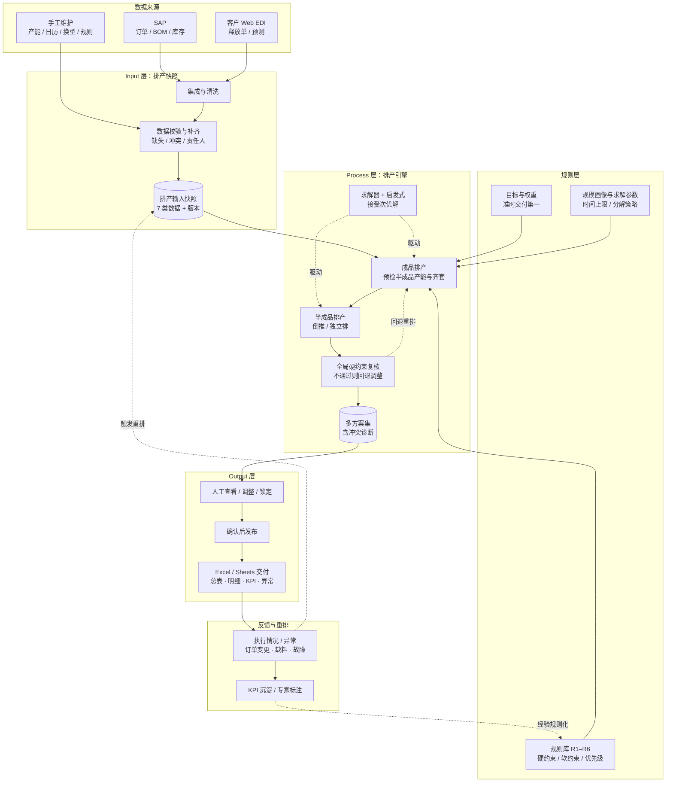

# 自研智能排产系统 Input – Process – Output 概览

**版本**：0.1 草案
**日期**：2026-10-03
**关联文档**：[aps_functional_spec.md](./aps_functional_spec.md)（功能规格）、[aps_checkList.md](./aps_checkList.md)（物流专家采访稿）
**文档目的**：用一页说清系统的输入、计算和输出边界，作为采访和开发的公共语言。重点在 Input。

---

## 一、总体架构



三层职责一句话：

- **Input 层**：把分散在 SAP、EDI、Excel 和专家脑子里的信息，固化成一份带版本、可复现的排产输入快照。
- **Process 层**：在规则和规模约束下，用可解释的方式算出若干可行方案，不追求最优。
- **Output 层**：以计划员现有的阅读与工作习惯交付结果，并把执行反馈重新灌回输入和规则。

---

## 二、Input：物流同事应该输入什么

判断 Input 是否充分，可以用一句话：

> 如果系统拿到这些输入，能复现物流专家 80% 的排产决策，输入就接近充分。

建议把 Input 分成 7 类。

| 类别 | 必须输入 | 白话解释 | 现有 Excel 可能对应 |
|---|---|---|---|
| 1. 需求 | 订单号、客户、产品、成品/半成品、数量、交期、优先级、变更 | 要生产什么、多少、什么时候要 | 订单表、客户 EDI 导出 |
| 2. 产品结构 | 成品、半成品、BOM、用量、损耗、替代料、提前期 | 成品由什么半成品组成，半成品由什么物料组成 | BOM 表、产品清单 |
| 3. 资源 | 产线、瓶颈工位、产能、班次、日历、休息日、换休、停机 | 哪些产线能做、能做多少、什么时候能做 | 产线产能表、日历 |
| 4. 物料与库存 | 原料、半成品、成品、在制品、可用库存、锁定库存、到货计划 | 现在有什么、还缺什么、什么时候到 | 库存表、在制表 |
| 5. 工艺与换型 | 工序、可生产产线、换型矩阵、清洗、模具、最小批量 | 换产品要多久，是否必须整批 | 换型表、工艺路线 |
| 6. 初始状态 | 已开工、已排产、已锁定、冻结期、在制分配 | 哪些不能动，哪些已经做了 | 已排计划、冻结清单 |
| 7. 规则与目标 | 硬约束、软约束、优先级、目标权重 | 什么绝对不能破，什么尽量优化 | 专家脑子、Excel 公式、备注 |

第 1 类需要进一步区分需求来源（释放单 / 客户预测 / 内部补货 / 插单），只有具交付约束力的需求才进入订单级排产，详见功能规格 4.6。

### Input 最小集合

MVP 至少需要：

1. 客户订单：产品、数量、交期、优先级，且明确属于哪一类需求来源。
2. 产品结构：成品和半成品 BOM。
3. 产线资源：产线、产能、日历、班次。
4. 库存：成品、半成品、原料、在制、可用量。
5. 换型：换型时间或矩阵。
6. 规则：硬约束、软约束、目标优先级，且可归入功能规格 5.2.1 的 R1–R6 类别。
7. 初始状态：已排、已锁定、已开工。
8. 规模画像：订单行数、SKU 数、产线数、计划跨度、时间粒度的典型值与峰值，见功能规格 4.5。

输出偏好（Excel / Google Sheets 模板）不属于 Input，属于 Output 层的交付约定，见本文第四节。

### 数据治理要求

Input 能不能长期用，取决于以下四项是否落实，缺任何一项都会在跑产一两个月后退化回 Excel：

- **来源唯一**：每类数据有明确的权威来源，SAP、EDI 和手工维护之间不冲突。
- **责任人**：手工维护的数据必须有名有姓的责任人和维护频率。
- **数据质量策略**：数据缺失或明显不准时的处理方式——阻断、提醒还是带标记继续算，需业务确认。
- **版本与可复现**：每次排产锁定一份输入快照，可回看"当时是基于什么数据排出来的"。

### 需要特别向物流专家确认的 Input 问题

- 现有 Excel 中哪些是真正的输入？
- 哪些是专家临时算的中间结果？
- 哪些数据没有，但专家靠经验补的？
- 哪些数据经常不准？
- 哪些数据必须实时，哪些可以每天一次？
- 哪些数据今天根本没有，必须新建维护流程？

---

## 三、Process：粗略流程

MVP 的 Process 可以粗略理解为"规则 + 求解器 + 人工确认"：

```text
1.  读取输入快照
2.  数据校验与补齐（不通过则阻断或标记）
3.  加载排产规则、目标权重与求解参数
4.  预检查：产能与齐套粗校验，判断需求总量是否可行
5.  排成品，落料时对半成品产能与库存做可行性预检
6.  排半成品，按成品计划倒推或独立排（模式待确认）
7.  全局硬约束复核，不通过则回退第 5 步调整
8.  计算软约束得分与 KPI
9.  生成多个方案；无解时输出冲突诊断与放宽建议
10. 人工查看、调整、锁定，调整后重新校验
11. 确认后发布
12. 异常触发重排，回到第 1 步
```

关键点：

- **硬约束校验不能放在排完之后**。若成品全部排完才发现半成品产能或齐套不支持，前面的计算全部作废，且引擎不知道该往回收敛。正确做法是排成品时就带半成品产能的粗预检，排完半成品后再做全局复核，不通过则回退（对应功能规格 5.4 的反向约束）。
- **系统不追求最优**，追求可接受时间内、比人工好的可行解；超时时返回当前最佳解。
- **人工仍可调整**，但调整后必须重新校验约束和 KPI，避免手工改出不可执行计划。
- **专家经验变成规则、参数、权重、案例**，而不是写死在代码里。

---

## 四、Output：当前偏好与建议模板

当前已知输出偏好（以下均为待采访确认的假设，不是既定需求）：

- Excel 或 Google Sheets。
- 行：产线名称。
- 列：日期，一般一个月，主要看前几天。
- 单元格：数量。

需要进一步确认：

1. 单元格数量是成品产出、半成品产出，还是投料量？
2. 行是否要区分成品和半成品？
3. 多条产线生产同一产品如何显示？
4. 列是按天还是按班次？
5. 休息日、换休、停机、换型如何标记？
6. 是否需要颜色区分急单、锁定、异常？
7. 是否需要明细 Sheet 和 KPI Sheet？
8. 人工调整后是否回写系统？
9. 计划发布后如何送达车间和执行环节？若最终仍需计划员手工抄回原 Excel，系统不会被真正采用。

### 建议 Output 模板

#### Sheet 1：排产总表

| 产线 | 10-01 | 10-02 | 10-03 | ... | 10-31 |
|---|---|---|---|---|---|
| 产线 A | 数量 | 数量 | 休息 | ... | 汇总 |
| 产线 B | 数量 | 数量 | 数量 | ... | 汇总 |
| 产线 C | 换型 | 数量 | 数量 | ... | 汇总 |

要求：

- 行：产线，可扩展为"产线 + 成品/半成品"。
- 列：日期，前几天按天，后面可汇总。
- 单元格：计划数量。
- 颜色：正常、急单、锁定、异常、休息、换型。
- 可下载 Excel / Google Sheets。

#### Sheet 2：订单明细

| 订单号 | 客户 | 产品 | 成品/半成品 | 数量 | 交期 | 优先级 | 分配产线 | 计划日期 | 状态 |
|---|---|---|---|---|---|---|---|---|---|

#### Sheet 3：KPI

| 指标 | 值 | 对比人工基准 |
|---|---|---|
| 准时交付率 |  |  |
| 排产耗时 |  |  |
| 换型次数 |  |  |
| 产线利用率 |  |  |
| 瓶颈工位利用率 |  |  |
| 库存/在制 |  |  |
| 人工调整次数 |  |  |

#### Sheet 4：异常与重排

| 异常类型 | 影响订单 | 影响产线 | 建议动作 | 确认状态 |
|---|---|---|---|---|

---

## 五、与功能规格的对应关系

| 本文档 | 功能规格章节 |
|---|---|
| 一、总体架构 | 8. 技术路线倾向 |
| 二、Input 7 类 | 5.1 数据集成与主数据管理 |
| 二、需求来源区分 | 4.6 需求来源与订单形态 |
| 二、规模画像 | 4.5 问题规模与数据画像 |
| 二、数据治理要求 | 5.1、9. 风险 |
| 三、Process 规则与冲突 | 5.2 排产规则与约束配置、5.2.1 规则能力边界 |
| 三、Process 求解与超时 | 5.3 排产引擎、6.1 性能与求解策略 |
| 三、成品/半成品预检回退 | 5.4 成品与半成品联动 |
| 三、重排回路 | 5.6 重排与异常处理 |
| 四、Output 模板 | 5.5 排产结果展示与交互 |
| 四、KPI Sheet | 5.7 方案评估与知识沉淀 |

采访结束后，把答案填回功能规格第 11 章"悬而未决问题"。重点收敛：

1. 硬约束清单。
2. 软约束清单。
3. 目标优先级：准时交付第一之后是什么。
4. 问题规模数值（4.5 表格）。
5. 需求来源边界（4.6）。
6. Input 最小集合。
7. Output 模板。
8. 重排触发条件与冻结期。
9. 成品/半成品联动方式。
10. 验收 KPI 和人工基准。

以上确认，MVP 的功能边界基本就清楚了。
