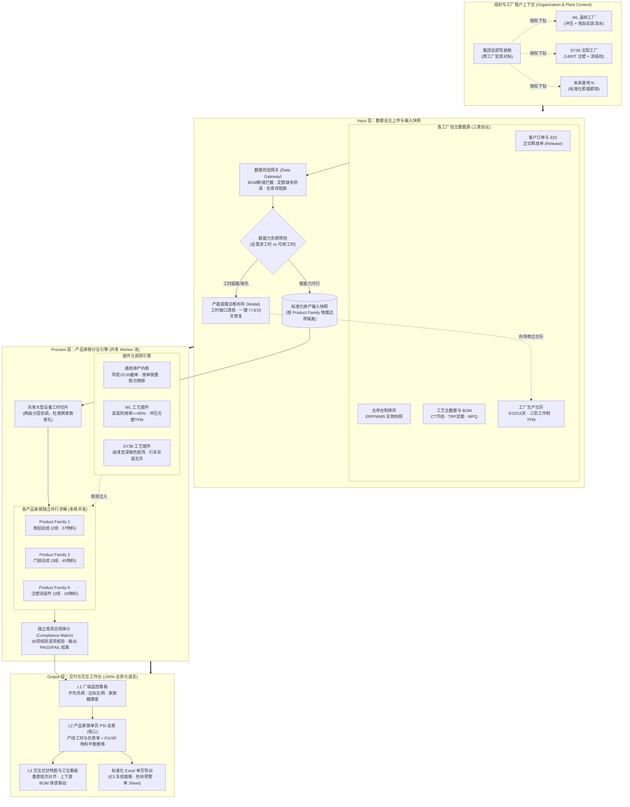

# 自研智能排产系统 Input – Process – Output 概览

**版本**：0.3 演进版  
**日期**：2026-10-18  
**关联文档**：[aps_functional_spec.md](./aps_functional_spec.md)（功能规格 0.4 版）  
**文档目的**：清晰定义跨工厂多租户架构下的输入快照（Input）、分治计算引擎（Process）与交付物形态（Output）边界，沉淀 MVP 成果并支撑温岭（WL）、沈阳（SY38）等多基地数据与规则自治。

---

## 一、多工厂多租户总体架构与数据流图



---

## 二、Input 层：多工厂自主输入与数据治理

系统输入分为“动态运行数据”与“准静态主数据”，严格按 **工厂租户（Plant/Site）** 与 **产品家族（Product Family）** 双重物理边界进行隔离：

| 数据类别 | 具体字段与要素 | 业务定义与作用 | 工厂差异化说明 |
| :--- | :--- | :--- | :--- |
| **1. 客户需求** | 订单号、料号、品名、交付日期、交期时刻（默认早班 15:00 截单）、需求数量 | 确定性交付对象，排产刚性基准 | 各工厂独立上传，WL（吉利/沃尔沃雨刮）、SY38（宝马/外饰件），互不可见。 |
| **2. 工厂日历与工作制** | 计划跨度（5/10/15天）、工作模式（7×3 连续、5×3 双休、4×3 极度空闲）、班次开关、TPM 维保标记 | 决定各产线在计划期内的总可用生产工时 | 独立维护。北方工厂（SY38）与南方工厂（WL）拥有完全独立的高温假/采暖/客休日历。 |
| **3. 产线与工时定额** | 产线代码、产线名称、产品家族归属、单班时长（8h）、TRP 综合工时利用定额 | 计算生产工时与负荷率的基准 | **WL**：装配 TRP 0.71，冲压 TRP 0.85；<br/>**SY38**：注塑 1400T 机台定额，涂装线链速与挂具定额。 |
| **4. 产品与制造参数** | 成品/半成品料号、单件生产节拍 CT（秒）、最小包装批量 MPQ | 产线批量化投产与节拍核算的核心参数 | 各厂自主导入。注塑包含成型周期，涂装包含喷涂节拍与换色清洗时间。 |
| **5. 静态与在制库存** | 各物料期初在库实物库存（件）、在制品数量 | 计算净需求与物料结存推移的起点基准 | 各工厂 ERP/WMS 独立抓取实物快照。 |
| **6. 工艺 BOM 关系** | 成品料号 $\to$ 半成品料号 $\to$ 单机消耗比例（Ratio） | 两阶段装配流与零部件联动平衡的刚性纽带 | **WL**：总装 $\to$ 轴套；<br/>**SY38**：喷涂总成 $\to$ 注塑素件 $\to$ 色母/原料。 |
| **7. 规则配置开关** | 通用核心规则 + 工厂专属工艺插件勾选状态 | 控制排产引擎的计算目标权重与边界 | 各工厂独立勾选。SY38 不展示 WL 的规则，WL 不展示涂装换色规则。 |

### 数据自治上传防呆网关（Data Validation Gateway）
各工厂通过标准 Excel 模板自主导入时，前置网关实施“三不准”刚性拦截：
1. **BOM 孤儿料号断链**：严禁出现成品有需求但前道子件未配置 BOM；
2. **定额缺失**：严禁出现物料缺少 CT 节拍或 TRP 定额（标红提示或启用安全兜底）；
3. **数据逻辑冲突**：拦截交期倒挂（早于基准日）与负数期初库存，精确定位至 Excel 行号。

---

## 三、Process 层：计算隔离与插件化流水线

计算流程遵循 **“无状态沙箱隔离 $\to$ 粗能力预检 $\to$ 专属插件求解 $\to$ 独立合规审计”**：

```text
Step 1. 租户沙箱初始化：根据当前登录工厂上下文（如 WL 或 SY38）加载专属输入快照与规则插件。
Step 2. 粗能力预检 (Capacity Precheck)：
        - 核算总需求工时 vs 当前日历工作制总可用工时；
        - 若出现工时赤字或周末停工导致交期穿孔，立即拦截并触发【产能超载诊断向导】；
        - 提供“一键切换 7×3 连续生产”、“一键切换 15 天计划”或“手动加开班次”修复建议。
Step 3. 共享设备分层切片 (针对多家族场景)：
        - 对跨家族共用的 1400T 冲压机或涂装线，根据各家族需求工时权重，分配各班次工时配额。
Step 4. 插件化协同求解 (Product Family 并发执行)：
        - 【通用内核】：准时交付倒排、工单整 MPQ 投入、按单锁量防超产闭环；
        - 【WL 工厂插件】：装配-冲压两阶段流水平衡，开工班次工时利用率收拢至 >= 95%（尾班豁免）；
        - 【SY38 工厂插件】：涂装浅色到深色换色顺序优化（减少洗枪损耗）、行车模具互斥、烘烤固化时限控制。
Step 5. 独立合规性审计 (Post-Solve Compliance Audit)：
        - 由独立验证器对 30 项规则执行校验，输出合规雷达与违规明细。
Step 6. 结果装配与交付：生成单页 PSI 矩阵、产线负荷及甘特图定位数据。
```

---

## 四、Output 层：多级展示与业务语言规范

### 1. 业务化语言规范（100% 拒绝系统黑话）
全界面（UI）、系统提示、弹窗及导出报表中，彻底剔除底层技术词汇：
- 严禁出现：`OR-Tools`、`CP-SAT`、`求解器`、`数学建模`、`运筹优化`；
- 统一规范为：**智能排产引擎**、**生产计划编制**、**产线开工负荷率**、**工序流水动态平衡**、**早班交付截单**。

### 2. 核心交付视图一览

#### 视图 A：集团跨工厂监控驾驶舱（Group Level Cockpit）
* **定位**：面向集团供应链总监与管理层；
* **内容**：横向拉通对比 WL 温岭工厂、SY38 沈阳工厂及未来基地的：
  - 客户订单准时交付率（OTD 对比）；
  - 综合产线开工负荷率（产能饱和度热力图）；
  - 呆滞与安全库存周转天数。

#### 视图 B：工厂专属产品家族工作台（单页 PSI 表，合并同屏展示）
* **定位**：各工厂计划员核心工作台，100% 垂直列精准对齐（日期与早/中/晚班）；
* **【上表】产线负荷概览（Line Loads Overview）**：
  - 显示各产线的生产工时（Loading Hours）、TRP 定额、开工负荷率（Loading Rate）；
  - 负荷率达标（$\ge 95\%$）淡绿高亮，尾班浅黄，未达标淡红预警；
* **【下表】物料动态平衡表（PSI Balance Matrix）**：
  - 完整合并呈现该家族全部产成品（FG）与半成品（SFIN）；
  - 固定 4 行推移：`Customer Demand`（黄色高亮）、`Production Plan`（蓝色高亮）、`Stock Balance`（负库存红色警示）、`Coverage Days`（$\le 2$ 天安全预警）。

#### 视图 C：标准化单页 Excel 报表（Single-Sheet Export）
- **单工作表结构**：点击“导出结果 Excel”仅生成一个名为 `生产排程与物料平衡总表 (PSI)` 的工作表，废弃繁冗的多 Sheet 模板；
- **冻结窗格**：锁定在 `E3`，前 4 列（料号、品名、监控指标、基准参数）及前 2 行日期班次表头在上下左右滚动时全局冻结；
- **视觉风格**：细灰边框、色块高亮与系统屏幕保持完全一致。

#### 视图 D：交互式排班甘特图与工位看板
- **直观时间刻度**：双层表头标注日期与早/中/晚班；
- **BOM 穿透闪烁**：点击总装工单卡片，联动高亮其前道半成品备料工单，展示上下游工序衔接与安全缓冲时长（Slack Hours）。
